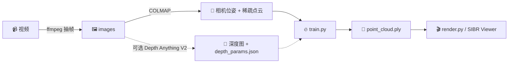

<div align="center">

# 🌌 3D Gaussian Splatting 实战流程

**从一段手机视频，到可实时漫游的高斯场景**


</div>

---

## 📖 简介

本文档记录了基于官方 [gaussian-splatting](https://github.com/graphdeco-inria/gaussian-splatting) 在 **Windows** 下的完整复现流程，包含：

- 环境搭建与 CUDA 子模块编译
- 视频抽帧、COLMAP 位姿估计
- 可选的**单目深度监督**训练（Depth Anything V2）
- 渲染、转视频、SIBR 实时查看

整体流程如下：



## 📑 目录

- [1. 环境准备](#1-环境准备)
- [2. 数据准备](#2-数据准备)
- [3. 模型训练](#3-模型训练)
- [4. 结果查看](#4-结果查看)
- [5. 目录结构](#5-目录结构)
- [6. 常见问题](#6-常见问题)

> 💡 下文路径均以 `D:\temp\3DGS\gaussian_splatting` 为根目录、`Bottle` 为示例对象，请按实际情况替换。`xxxxxxxx` 代表训练自动生成的输出文件夹名。

---

## 1. 环境准备

### 1.1 克隆代码并创建环境

```bash
git clone https://github.com/graphdeco-inria/gaussian-splatting --recursive
cd gaussian-splatting
conda create -n gaussian_splatting python=3.10
conda activate gaussian_splatting
```

### 1.2 安装 PyTorch（以 CUDA 12.4 为例）

```bash
conda install pytorch torchvision torchaudio pytorch-cuda=12.4 -c pytorch -c nvidia
```

### 1.3 编译 CUDA 子模块

打开 **「x64 Native Tools Command Prompt for VS 2022」**，依次执行：

```bat
D:\Anaconda3\Scripts\activate.bat gaussian_splatting
cd /d D:\temp\3DGS\gaussian_splatting\Resources
SET DISTUTILS_USE_SDK=1
pip install --no-build-isolation submodules\diff-gaussian-rasterization
pip install --no-build-isolation submodules\simple-knn
```

> ⚠️ 必须在 VS 的 Native Tools 终端中编译，否则找不到 `cl.exe`。

### 1.4 安装辅助库

```bash
pip install plyfile tqdm opencv-python
```

---

## 2. 数据准备

### 2.1 视频抽帧

在 `Data` 目录下新建以对象命名的文件夹（如 `Bottle`），放入视频，并新建 `images` 文件夹：

```bat
cd D:\temp\3DGS\gaussian_splatting\Data\Bottle
ffmpeg -i D:\temp\3DGS\gaussian_splatting\Data\Bottle\VID_20260425_195506.mp4 -qscale:v 1 -qmin 1 -vf fps=2 "D:\temp\3DGS\gaussian_splatting\Data\Bottle\images\%4d.jpg"
```

| 参数 | 说明 |
|---|---|
| `-qscale:v 1 -qmin 1` | 最高 JPEG 质量 |
| `-vf fps=2` | 每秒抽 2 帧，可按视频长度和运动速度调整 |

### 2.2 COLMAP 生成稀疏点云与相机位姿

在 COLMAP GUI 中依次操作：

1. **File → New project**
   - Database：`D:\temp\3DGS\gaussian_splatting\Data\Bottle\database.db`
   - Images：`D:\temp\3DGS\gaussian_splatting\Data\Bottle\images`
2. **Processing → Feature extraction**
   - 在 *ImageReader* 选项卡中，Camera model 选择 **`PINHOLE`**
   - 点击 **Extract**
3. **Processing → Feature matching** → 选择 **Exhaustive** → **Run**
4. **Reconstruction → Start reconstruction**
5. **File → Export model as text**
   - 导出目录：`D:\temp\3DGS\gaussian_splatting\Data\Bottle\sparse`

### 2.3 （可选）深度监督准备

> 仅在需要**深度训练**时执行，需先完成 2.2。

**① 生成深度图**（Depth Anything V2）

```bat
python run.py --encoder vitl --img-path D:\temp\3DGS\gaussian_splatting\Data\Bottle\images --outdir D:\temp\3DGS\gaussian_splatting\Data\Bottle\dpimage --pred-only --grayscale
```

**② 生成尺度对齐文件 `depth_params.json`**

```bat
cd D:\temp\3DGS\gaussian_splatting\Resources
python utils/make_depth_scale.py --base_dir D:\temp\3DGS\gaussian_splatting\Data\Bottle --depths_dir D:\temp\3DGS\gaussian_splatting\Data\Bottle\dpimage --model_type txt
```

---

## 3. 模型训练

```bat
cd D:\temp\3DGS\gaussian_splatting\Resources
```

| 模式 | 命令 |
|---|---|
| 🔹 **无深度训练** | `python train.py -s D:\temp\3DGS\gaussian_splatting\Data\Bottle` |
| 🔸 **有深度训练** | `python train.py -s D:\temp\3DGS\gaussian_splatting\Data\Bottle -d dpimage` |
| 🔸 **带参数输出** | `python train.py -s D:\temp\3DGS\gaussian_splatting\Data\Bottle -d dpimage --eval` |
> 有深度训练需要 `depth_params.json`（见 [2.3](#23-可选深度监督准备)）。训练完成后，结果保存在 `Resources/output/<随机ID>/`。

---

## 4. 结果查看

### 4.1 输出渲染图片

```bat
cd D:\temp\3DGS\gaussian_splatting\Resources
python render.py -m ./output/xxxxxxxx
```

渲染图保存在 `output/xxxxxxxx/train/ours_30000/renders`。

### 4.2 渲染图转视频

```bat
cd D:\temp\3DGS\gaussian_splatting\Resources\output\xxxxxxxx\train\ours_30000\renders
ffmpeg -framerate 5 -i %05d.png -c:v libx264 -pix_fmt yuv420p -crf 18 output.mp4
```

| 参数 | 说明 |
|---|---|
| `-framerate 5` | 帧率，越小播放越慢、越容易看清细节 |
| `-crf 18` | 画质，数值越小越清晰（推荐 17–23） |

### 4.3 查看渲染效果打分
```bat
cd D:\temp\3DGS\gaussian_splatting\Resources
python metrics.py -m output\xxxxxxxx
```

### 4.4 实时查看高斯模型

```bat
D:\temp\3DGS\gaussian_splatting\Viewers\bin\SIBR_gaussianViewer_app.exe -m D:\temp\3DGS\gaussian_splatting\Resources\output\xxxxxxxx
```

指定迭代轮数：追加 `--iteration 7000`。

---

## 5. 目录结构

```text
gaussian_splatting/
├── Resources/                 # 官方代码
│   ├── train.py
│   ├── render.py
│   ├── submodules/
│   └── output/
│       └── xxxxxxxx/
│           ├── cfg_args
│           ├── cameras.json
│           ├── point_cloud/iteration_30000/point_cloud.ply   # ⭐ 最终高斯模型
│           └── train/ours_30000/renders/                     # 渲染图
├── Viewers/bin/               # SIBR 查看器
└── Data/
    └── Bottle/
        ├── images/            # 抽帧图片
        ├── sparse/            # COLMAP 导出（文本）
        ├── dpimage/           # 深度图（可选）
        ├── depth_params.json  # 深度尺度参数（可选）
        └── database.db
```

---

## 6. 常见问题

<details>
<summary><b>❓ 渲染出的视频一闪而过？</b></summary>

训练相机只有几十张，30 fps 下仅 1~2 秒。降低 `-framerate`，或在相机之间插值生成更多视角再渲染。

</details>

<details>
<summary><b>❓ 能把结果导入 Blender / ZBrush 当模型用吗？</b></summary>

`point_cloud.ply` 是高斯场景表示，不是网格，不能直接编辑。如需网格，可使用 2DGS、SuGaR 等方法，或改用传统摄影测量（Metashape、RealityCapture、Meshroom）。

</details>

<details>
<summary><b>❓ 加了深度监督后仍有重影？</b></summary>

重影主要来自 COLMAP 位姿误差、曝光不一致或动态物体。优先检查重投影误差（应 < 1 px）和注册成功的图片数。

</details>

<details>
<summary><b>❓ 编译子模块时报错找不到 cl.exe？</b></summary>

请确认在「x64 Native Tools Command Prompt for VS 2022」中执行，并已设置 `SET DISTUTILS_USE_SDK=1`。

</details>

---

## 🙏 致谢

- [3D Gaussian Splatting for Real-Time Radiance Field Rendering](https://github.com/graphdeco-inria/gaussian-splatting)
- [COLMAP](https://colmap.github.io/)
- [Depth Anything V2](https://github.com/DepthAnything/Depth-Anything-V2)
- [FFmpeg](https://ffmpeg.org/)